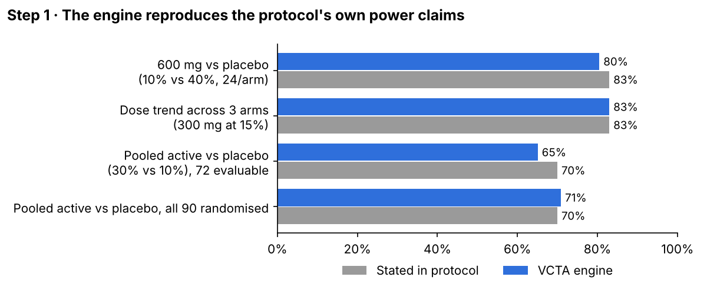
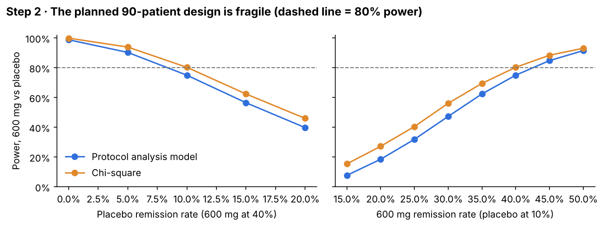
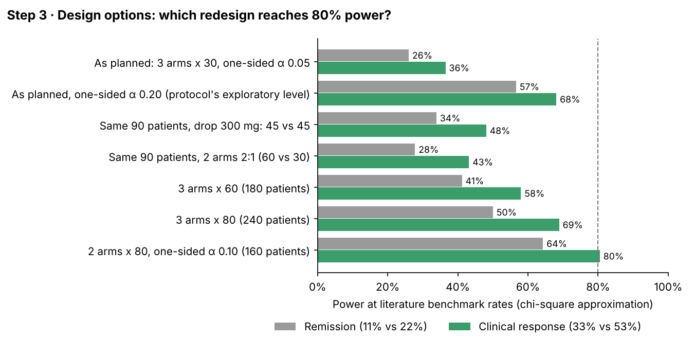
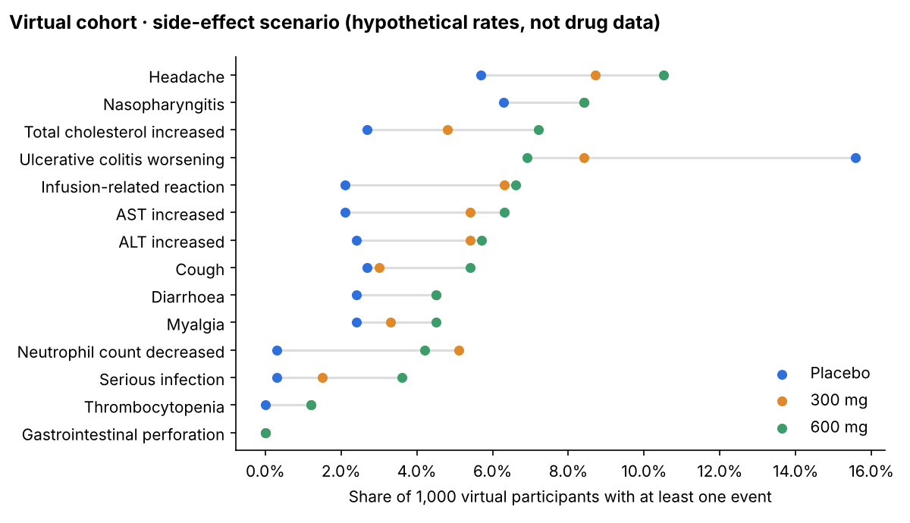
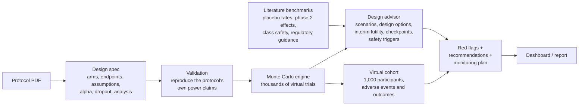

# VCTA — Virtual Clinical Trial Agent

**Stress-testing a clinical trial design before a single patient is enrolled.**

VCTA is a prototype that reads a trial protocol's design, simulates thousands of virtual trials and virtual patients, and tells a sponsor three things before the trial starts:

1. **Do the protocol's own numbers hold up?** (Can its power claims be reproduced?)
2. **How fragile is the design** if the assumptions turn out wrong?
3. **What should change** (design, endpoint, sample size, monitoring) to give the trial a realistic chance of a clear answer, and which **checkpoints** keep it on track once it runs?

This repository is a full case study on a real, publicly posted phase II protocol: **TJ301 (olamkicept) in active ulcerative colitis** (protocol CTJ301UC201 v1.1, [NCT03235752](https://clinicaltrials.gov/study/NCT03235752)).

> ⚠️ **Guardrails.** Simulated participants are not patients. Nothing here shows that any drug is safe or effective, and nothing here supports exposing people to a drug without the usual ethics, regulatory and expert review. VCTA is a hypothesis-testing and design-exploration tool, not a replacement for clinical trials.

---

## Why this matters

Many phase II trials fail not because the drug is useless but because the trial was **designed around optimistic assumptions**: too large an expected effect, too low an expected placebo response, too few patients, or an analysis that doesn't match the sample-size calculation. Those problems are visible *before* the trial starts, if someone simulates the design against what comparable trials actually achieved.

## Headline findings (TJ301 case study)

| Question | Answer |
|---|---|
| Power the protocol states (600 mg vs placebo) | **83%** |
| Power the engine reproduces with the protocol's own test | **80.5%** pairwise; **83%** with a dose-trend test |
| Power as randomised (90 patients, 20% dropout) with the protocol's own analysis model | **75%** |
| Power if remission rates match comparable trials (11% placebo vs 22% on drug) | **18%** |
| Patients per arm needed for 80% power at those rates (remission) | **~182** (vs 30 planned) |
| Recommended redesign: 2 arms × 80, clinical-response primary, one-sided α 0.10 | **~80%** |

**Red flags found before the first patient:** an effect assumption (40% remission) matching the strongest UC phase 2 result on record; a sample-size method that differs from the analysis model; a statistical model that fails in 8% of simulated trials (no placebo remitters) without Firth/exact methods pre-specified; a 300 mg arm with ~18% power; no interim futility look or unblinded monitoring committee; and an IL-6-class safety signal (GI perforation/abscess) that needs pre-set review triggers.

Full write-up: [`docs/case-study.md`](docs/case-study.md)

### Step 1 — Validate the engine against the protocol's own numbers


### Step 2 — Show how fragile the planned design is


### Step 3 — Compare redesigns at evidence-based rates


### Virtual cohort — 1,000 simulated participants with side-effect scenarios


---

## How it works



**Design principle:** AI may plan, extract and explain; **deterministic, tested code does every calculation.** No number in the output comes from a language model.

| Component | File | What it does |
|---|---|---|
| Design spec | `simulator/trial_config.json` | The protocol's design and assumptions as structured data; anything not in the protocol is marked `ASSUMED` |
| Engine | `simulator/engine.py` | Patient-level Monte Carlo: virtual cohorts, calibrated outcomes, dropout, chi-square and Firth-penalised logistic regression (vectorised NumPy) |
| Claims check | `simulator/check_claims.py` | Exact enumeration, normal approximation and Cochran–Armitage trend test to reproduce the protocol's power statements |
| What-if scenarios | `simulator/scenarios.py`, `export.py` | Power vs effect size, placebo rate, dropout and sample size |
| Virtual cohort | `simulator/cohort.py` | 1,000 virtual participants with profiles, week-12 outcome and adverse events (severity, causality, action, outcome per protocol categories) |
| Design advisor | `simulator/advisor.py`, `report.py` | Benchmark scenarios, design options, endpoint comparison, interim futility operating characteristics, blinded checkpoints, Bayesian safety triggers; then red flags, recommendations and checkpoints written from those results |
| Tests | `tests/test_engine.py` | 9 validation tests against known answers |

More detail: [`docs/methodology.md`](docs/methodology.md)

## Validation

The engine is only trusted where it can be checked:

- **Reproduces the protocol's own power calculation** with three independent methods (exact enumeration, normal approximation, simulation).
- **Automated tests** (`pytest`): exact vs approximate agreement, simulation vs exact, the 83% trend-test claim, type I error control under no effect, calibration of target rates, Firth regression under separation, monotone dropout effect, safety-trigger thresholds and virtual-cohort integrity.
- **Retrospective back-test:** the trial has since been run and published. Feeding the published rates into the engine shows the design's real power on each endpoint — see [`docs/validation.md`](docs/validation.md). This comparison is kept separate from the pre-trial advisor, which uses only the protocol and literature available before the trial.

What is **not** validated yet is listed honestly in [`docs/limitations.md`](docs/limitations.md).

## Quick start

```bash
git clone https://github.com/<your-username>/vcta-virtual-clinical-trial-agent.git
cd vcta-virtual-clinical-trial-agent
python -m venv .venv && source .venv/bin/activate      # Windows: .venv\Scripts\activate
pip install -r requirements.txt

pytest -q                         # 9 validation tests, ~2 seconds
python simulator/run_all.py       # regenerate every result (about 5 minutes)
python docs/make_charts.py        # redraw the charts in docs/images
```

Python 3.11–3.13 recommended. No GPU, no paid APIs, runs on a 16 GB laptop.

**Change the assumptions:** edit `remission_rate` in `simulator/trial_config.json`, the scenario list in `simulator/advisor.py`, or the `AE_CATALOGUE` in `simulator/cohort.py`, then rerun.

## Repository structure

```
├── README.md
├── requirements.txt
├── simulator/
│   ├── trial_config.json      # design spec extracted from the protocol
│   ├── engine.py              # Monte Carlo engine
│   ├── check_claims.py        # reproduce the protocol's power claims
│   ├── scenarios.py, export.py
│   ├── cohort.py              # 1,000 virtual participants + adverse events
│   ├── advisor.py             # design advisor: options, interim, checkpoints, safety
│   ├── report.py              # red flags, recommendations, checkpoints (text built from results)
│   ├── run_all.py
│   └── data/                  # all generated results (CSV/JSON)
├── tests/test_engine.py
├── docs/
│   ├── case-study.md          # full narrative
│   ├── methodology.md
│   ├── validation.md
│   ├── limitations.md
│   ├── roadmap.md             # towards a universal agentic advisor
│   ├── make_charts.py
│   └── images/
└── dashboards/README.md       # links to the interactive dashboards
```

## Roadmap: from case study to a universal agentic advisor

The next version generalises VCTA to any protocol: an **intake agent** turns a protocol PDF into the design spec, an **evidence agent** pulls benchmarks from ClinicalTrials.gov and PubMed, a **design-check engine** runs reusable failure-mode checks, a **recommender agent** simulates and ranks redesigns, and an independent **critic agent** re-checks every number before a report is produced. See [`docs/roadmap.md`](docs/roadmap.md).

## Sources

The protocol itself is not redistributed here; it is publicly posted on ClinicalTrials.gov. Benchmarks are cited in [`simulator/data/adv_benchmarks.csv`](simulator/data/adv_benchmarks.csv) and [`docs/case-study.md`](docs/case-study.md).

## About

Built by **Chaitanya Kotaru** | Pharmaceutical professional with 13+ years of experience in clinical outsourcing, strategic sourcing and vendor management. MSc Pharmaceutical Sciences | Strategic Digital Leadership Programme, ISB. Exploring the intersection of Pharma, AI, Data Science and Agentic AI to transform clinical research and healthcare operations.

## License

MIT — see [`LICENSE`](LICENSE).
