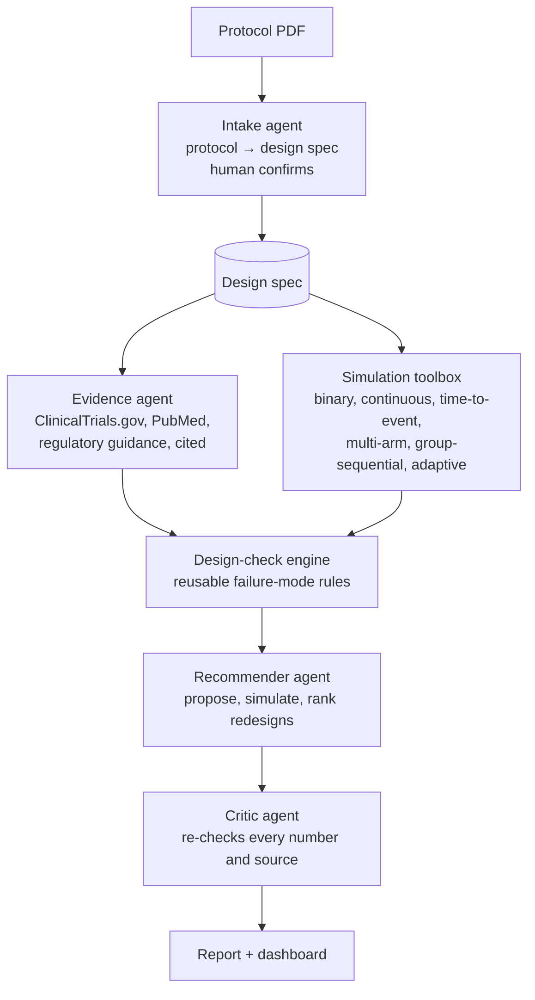

# Roadmap: a universal agentic trial-design advisor

Goal: an agentic AI that takes **any** protocol, checks the design and gives sponsors evidence-based recommendations and in-trial checkpoints. Agents plan, extract, retrieve and explain; tested code does all calculations.

## Phases
1. **Generalise the engine:** design-spec schema; any number of arms and allocation; continuous endpoints (ANCOVA/MMRM); retest on TJ301 and a second protocol in another disease area.
2. **Design-check rules:** turn the TJ301 red flags into automatic checks — power claims reproduce; assumptions within benchmark range; sample-size method matches analysis; multiplicity and estimands (ICH E9(R1)); endpoint aligned with regulators; interim/DMC present; class safety risks monitored; enrolment feasibility.
3. **Intake and evidence agents:** protocol → spec (local LLM, API model for intake only, or human-in-the-loop); benchmark retrieval with citations.
4. **Recommender and critic agents;** automatic dashboard and written report.
5. **Systematic back-test:** run the advisor on 20–30 completed trials with posted protocols and results; publish how often its red flags predicted real outcomes.

## Constraints
- Local-first and free where possible (Python, Ollama). Small local models (e.g. 4B) can orchestrate tools but are not reliable for long-protocol extraction.
- Start narrow: phase 2, binary and continuous endpoints, one or two disease areas.
